<!-- Portfolio URL used throughout: https://www.mujeebansari.com — find & replace if your live domain is different -->

<a href="https://www.mujeebansari.com">
  
</a>

<p align="center">
  <a href="https://www.mujeebansari.com"></a>
  <a href="https://www.linkedin.com/in/mujeebansari786/"></a>
  <a href="mailto:muzeeb100@yahoo.co.in"></a>
  <a href="https://x.com/mujeeb20010"></a>
</p>

<br />

I build **AI products end to end**: the React interface, the Python service behind it, the data and LLM layer underneath, and the pipeline that ships all of it.

For **6+ years** I've shipped production software for **fintech, payroll and telecom** teams, including **Vodafone Idea**, **Vistra** and **Niyogin**. Frontend is my strongest layer, and I work in the three below it too.

```python
class MujeebAnsari(Engineer):
    role       = "Full Stack AI Engineer"
    based_in   = "Mumbai, India  ·  remote worldwide"
    experience = "6+ years"

    ui    = ["React", "TypeScript", "Next.js", "Tailwind", "RTK Query", "Three.js"]
    api   = ["Python", "FastAPI", "Django", "Node.js", "REST"]
    ai    = ["LLM APIs", "RAG", "Embeddings", "PostgreSQL", "pgvector"]
    cloud = ["Azure DevOps", "Azure", "AWS", "Docker", "Vercel"]

    now     = "Building AI-assisted products at Vodafone Idea"
    open_to = ["Senior Frontend", "Full Stack", "AI Engineering"]

    def principle(self) -> str:
        return "Own the feature from interface to cloud."
```

<br />

## ◆ The stack, layer by layer

<table>
  <tr>
    <td width="150"><code>L1 /ui</code><br /><sub><b>Interface</b></sub></td>
    <td></td>
    <td><sub>Design systems, accessibility, role-aware UIs, data dashboards, streaming chat, WebGL</sub></td>
  </tr>
  <tr>
    <td><code>L2 /api</code><br /><sub><b>Services</b></sub></td>
    <td></td>
    <td><sub>Typed REST APIs, Pydantic validation, JWT auth, OpenAPI docs, response normalisation</sub></td>
  </tr>
  <tr>
    <td><code>L3 /ai</code><br /><sub><b>Data &amp; AI</b></sub></td>
    <td>&nbsp;
      
      
      
      
      </td>
    <td><sub>AI assistants grounded in real data, AI insights on analytics, retrieval pipelines, SQL</sub></td>
  </tr>
  <tr>
    <td><code>L4 /cloud</code><br /><sub><b>Cloud</b></sub></td>
    <td></td>
    <td><sub>Azure DevOps CI/CD, Azure Static Web Apps, containers, serverless Python + Next.js deploys</sub></td>
  </tr>
</table>

<br />

## ◆ Selected work

<table>
  <tr>
    <td width="50%" valign="top">
      <h3>Ask Mujeeb: my portfolio</h3>
      <sub><code>/ui</code> <code>/api</code> <code>/ai</code> <code>/cloud</code></sub>
      <p>A full-stack AI product: a Next.js + <b>Three.js</b> frontend and a <b>FastAPI</b> service with a <b>BM25 retrieval</b> pipeline I wrote in pure Python, with optional LLM grounding. One push deploys both.</p>
      <sub>Next.js · React Three Fiber · FastAPI · Pydantic · RAG · Vercel</sub><br /><br />
      <a href="https://www.mujeebansari.com">Live ↗</a> &nbsp;·&nbsp; <a href="https://github.com/mujeeb100/mujeeb_portfolio">Code ↗</a> &nbsp;·&nbsp; <a href="https://www.mujeebansari.com/api/py/docs">API docs ↗</a>
    </td>
    <td width="50%" valign="top">
      <h3>Site Quality Management System</h3>
      <sub><code>/ui</code> <code>/api</code> <code>/cloud</code></sub>
      <p>Inspections → quality reports → corrective actions across multiple sites. <b>Role-based access for 6 roles</b> from one codebase, RTK Query cache tags that keep every view in sync, and <b>Azure DevOps CI/CD</b> to Azure Static Web Apps.</p>
      <sub>React · TypeScript · Tailwind · RTK Query · Azure DevOps</sub><br /><br />
      <a href="https://www.mujeebansari.com/work/site-quality-management">Case study ↗</a> &nbsp;·&nbsp; <sub>private codebase</sub>
    </td>
  </tr>
  <tr>
    <td width="50%" valign="top">
      <h3>Service IQ &amp; ViCare AI Assist</h3>
      <sub><code>/ui</code> <code>/api</code> <code>/ai</code> &nbsp;·&nbsp; Vodafone Idea</sub>
      <p>An analytics dashboard with <b>AI insights</b> and a session-aware <b>AI process assistant</b> built on live telecom APIs. It has KPI views, debt-ageing and billing-vs-collections charts, and a normalisation layer over inconsistent upstream data.</p>
      <sub>React · TypeScript · Recharts · LLM APIs · REST</sub><br /><br />
      <a href="https://www.mujeebansari.com/work/service-iq">Case study ↗</a>
    </td>
    <td width="50%" valign="top">
      <h3>OnePayroll Platform</h3>
      <sub><code>/ui</code> <code>/api</code> &nbsp;·&nbsp; Vistra</sub>
      <p>Multi-country payroll: pay cycles, payslips, tax and compliance reporting, and admin and employee portals. JWT-secured calls to a .NET API through RTK Query, with HR-system integrations and <b>i18n</b>.</p>
      <sub>React · Redux · RTK Query · TypeScript · i18n</sub><br /><br />
      <a href="https://www.onepayroll.net/">Product ↗</a> &nbsp;·&nbsp; <a href="https://www.mujeebansari.com/work/payroll-platform">Case study ↗</a>
    </td>
  </tr>
</table>

<br />

## ◆ Experience

```bash
$ git log --oneline career
a3f9c21 (HEAD -> present)  Software Engineer @ Vodafone Idea (Vi)            2024 — now
7be04d8                    Senior Frontend Engineer @ Vistra                  2023 — 2024
c51e9a0                    Frontend Developer @ Psychx86 · Niyogin FinTech    2022 — 2023
19d3f7e                    Frontend Developer @ Cloudage Software Solution    2021 — 2022
0e8b2c4                    UI Developer @ Oblix Technologies                  2019 — 2021
```

I'm also the founder of **[Elite Workforce International](https://eliteworkforceintl.com)**, an IT services and design agency for web, mobile, custom software and cloud projects.

<br />

<div align="center">

### Let's build something across the whole stack.

Open to **senior frontend, full stack and AI engineering roles**, full-time or contract, remote or in Mumbai.

<a href="mailto:muzeeb100@yahoo.co.in"></a>
<a href="https://www.mujeebansari.com/#ask"></a>

<br /><br />


</div>
